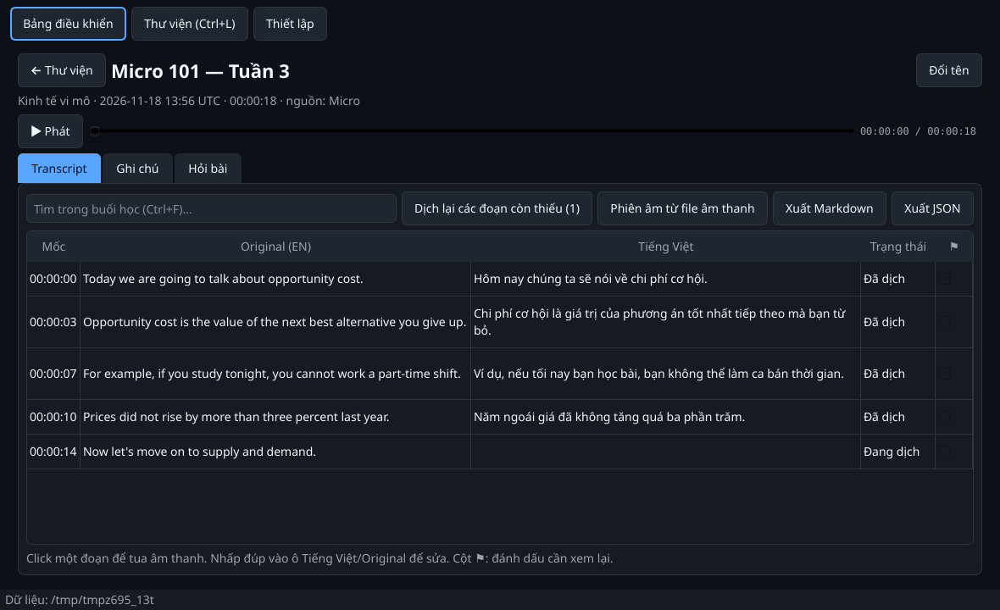
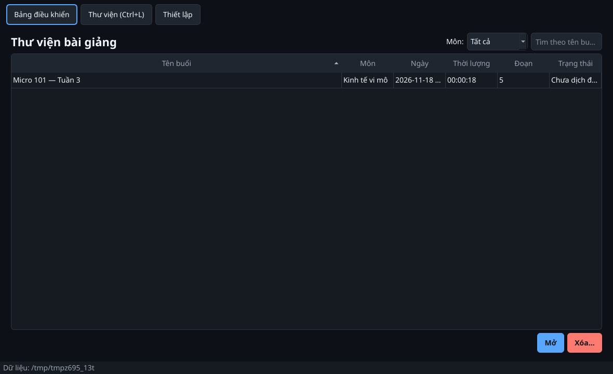

# LectureMate AI

**Trợ lý nghe giảng và ôn tập trên Windows.**

LectureMate AI kết hợp ghi âm, phụ đề song ngữ, bản dịch tiếng Việt và ghi chú AI trong một ứng dụng desktop. Theo dõi bài giảng tại lớp hoặc lớp học online, sau đó nghe lại từng đoạn, tìm nội dung quan trọng và hỏi đáp ngay trên bài đã lưu.

Âm thanh được xử lý trên máy bằng Faster-Whisper. Các tính năng dịch, tóm tắt và hỏi đáp sử dụng API AI do bạn cấu hình.

## Tính năng nổi bật

| Tính năng | Bạn có thể làm gì? |
| --- | --- |
| Phụ đề song ngữ trực tiếp | Tự nhận diện ngôn ngữ, hiển thị bản dịch tiếng Việt cùng nguyên văn và mốc thời gian. |
| Thu âm tại lớp và học online | Chọn micro hoặc âm thanh hệ thống qua WASAPI loopback; kiểm tra đầu vào trước khi bắt đầu. |
| Hỗ trợ micro tín hiệu yếu | Lọc tiếng ù trầm và tăng mức lời nói cho đường phiên âm, không thay đổi bản ghi WAV gốc. |
| Nghe lại theo nội dung | Bấm vào một đoạn transcript để tua đến vị trí tương ứng; sửa văn bản và đánh dấu đoạn cần xem lại. |
| Tóm tắt và ghi chú AI | Tạo tóm tắt tiếng Việt sau buổi học, chỉnh sửa ghi chú và truy cập các mốc thời gian được dẫn. |
| Hỏi đáp theo bài giảng | Đặt câu hỏi dựa trên transcript, xem các đoạn liên quan và nghe lại nguồn của câu trả lời. |
| Thư viện bài giảng | Lưu buổi học theo môn, tìm kiếm, đổi tên và quản lý nội dung đã ghi. |
| Thuật ngữ theo môn học | Tạo từ điển Anh–Việt hoặc nhập CSV để bổ sung ngữ cảnh cho bản dịch. |
| Xuất tài liệu | Xuất transcript Markdown/JSON, bản dịch tổng TXT và ghi chú Markdown. |
| Giao diện tùy chỉnh | Chọn giao diện sáng/tối, cỡ chữ phụ đề và tự cuộn theo nội dung mới. |

## Giao diện

Xem lại bài giảng với transcript song ngữ, trình phát âm thanh và các công cụ ôn tập.



<details>
<summary>Xem thư viện bài giảng</summary>



</details>

*Ảnh minh họa sử dụng nội dung bài giảng mẫu.*

## Yêu cầu hệ thống

- Windows 10/11 x64.
- Python 3.10 trở lên nếu chạy từ mã nguồn. Bản portable tự đóng gói không yêu cầu cài Python trên máy sử dụng.
- Micro để thu âm tại lớp, hoặc thiết bị phát âm thanh để thu tiếng từ lớp học online.
- Kết nối Internet khi cài đặt, tải model nhận dạng lần đầu và sử dụng API AI.
- Không bắt buộc có GPU hay Ollama. Tốc độ phiên âm phụ thuộc phần cứng, model và chất lượng âm thanh đầu vào.

## Cài đặt từ mã nguồn

Mở PowerShell và chạy:

```powershell
git clone https://github.com/dungprovaidai/LectureMate.git
cd LectureMate
python -m venv .venv
.\.venv\Scripts\python.exe -m pip install --upgrade pip
.\.venv\Scripts\python.exe -m pip install -e ".[all]"
.\.venv\Scripts\python.exe -m lecturemate
```

Nếu đã tải và giải nén mã nguồn, mở PowerShell trong thư mục dự án và bắt đầu từ lệnh `python -m venv .venv`.

Lần đầu phiên âm, ứng dụng tải model đã chọn về `%LOCALAPPDATA%\LectureMate\models`. Hãy để quá trình tải hoàn tất trước khi sử dụng ngoại tuyến.

### Thiết lập API AI

Ghi âm và phiên âm cục bộ không yêu cầu API key. Để dùng dịch tiếng Việt, tóm tắt và hỏi đáp:

1. Mở **Thiết lập → API dịch**.
2. Nhập **Base URL**, **Model** và **API key** theo tài khoản của bạn. Ứng dụng có cấu hình mặc định cho Agnes và sử dụng giao thức Chat Completions tương thích OpenAI.
3. Bấm **Lưu key**, sau đó **Thử kết nối** và lưu thiết lập.
4. Nhập đơn giá token của nhà cung cấp nếu muốn theo dõi chi phí ước tính và đặt giới hạn ngân sách.

API key được lưu bằng Windows Credential Manager, không nằm trong file cấu hình. Khả năng truy cập model, hạn mức và chi phí API phụ thuộc nhà cung cấp và tài khoản của bạn; đơn giá trong ứng dụng không tự cập nhật.

## Bắt đầu một buổi học

### 1. Chọn nguồn âm thanh

- **Microphone:** dùng khi nghe giảng trực tiếp. Lựa chọn mặc định ưu tiên micro vật lý thay vì Stereo Mix.
- **System Audio:** dùng khi nghe bài giảng, xem video hoặc học online trên máy tính.

Mỗi buổi học sử dụng một nguồn âm thanh. Bấm **Thử 5 giây** để kiểm tra mức thu; với micro, giữ im lặng lúc đầu rồi nói khi ứng dụng nhắc.

### 2. Theo dõi và lưu bài giảng

Nhập tên buổi học, chọn môn nếu cần rồi bấm **Bắt đầu**. Bản dịch tiếng Việt hiển thị phía trên, nguyên văn phía dưới. Bạn có thể tạm dừng, tiếp tục hoặc kết thúc để lưu buổi học vào thư viện.

Trong **Thiết lập → Âm thanh & ASR**, chọn nhịp dịch phù hợp:

- **Tự nhiên:** chờ hết cụm hoặc câu để bản dịch ổn định hơn.
- **Nhanh:** cập nhật bản dịch nháp thường xuyên hơn, đồng thời có thể tăng số lượt gọi API.

### 3. Ôn tập sau buổi học

Mở buổi học trong **Thư viện** để:

- Nghe lại và bấm vào transcript để tua theo đoạn.
- Tìm kiếm, sửa nguyên văn hoặc bản dịch và đánh dấu phần cần kiểm tra.
- Đọc **Dịch tổng** hoặc xuất bản dịch tiếng Việt ra TXT.
- Tạo tóm tắt AI, bổ sung ghi chú của riêng bạn và hỏi về nội dung bài giảng.
- Xuất transcript và ghi chú để lưu trữ hoặc đưa vào tài liệu học tập.

Tùy chọn tự tạo tóm tắt khi kết thúc nằm trong **Thiết lập → API dịch** và được bật mặc định; tính năng này cần API key và transcript.

## Quyền riêng tư và dữ liệu

- **Âm thanh ở trên máy:** ghi âm WAV và nhận dạng giọng nói không gửi âm thanh tới API AI.
- **AI sử dụng văn bản:** khi dùng dịch, tóm tắt hoặc hỏi đáp, nội dung transcript cần thiết được gửi tới nhà cung cấp API bạn cấu hình.
- **Lưu trữ cục bộ:** không có đồng bộ đám mây tích hợp. Bạn quản lý và xóa các buổi học trong thư viện.
- **Quyền ghi âm:** chỉ ghi âm khi được phép và tuân thủ quy định của lớp học hoặc tổ chức.

| Dữ liệu | Vị trí mặc định trên Windows |
| --- | --- |
| Transcript, bản dịch và ghi chú | `%LOCALAPPDATA%\LectureMate\lecturemate.db` |
| Bản ghi âm | `%LOCALAPPDATA%\LectureMate\audio\` |
| Model nhận dạng giọng nói | `%LOCALAPPDATA%\LectureMate\models\` |
| Cấu hình ứng dụng | `%LOCALAPPDATA%\LectureMate\config.json` |
| API key | Windows Credential Manager, mục `LectureMate` |

## Câu hỏi thường gặp

### Có dùng được khi không có Internet không?

Có thể ghi âm và phiên âm cục bộ sau khi đã cài đầy đủ thư viện và tải model. Dịch, tóm tắt và hỏi đáp AI cần kết nối tới API. Với các đoạn chưa có bản dịch, mở buổi học và chọn **Dịch lại các đoạn còn thiếu** khi kết nối khả dụng.

### Máy không theo kịp phụ đề trực tiếp thì làm gì?

Chọn model `tiny` hoặc `base`, hoặc chuyển sang **Chỉ ghi âm — phiên âm & dịch sau buổi** trong **Thiết lập → Âm thanh & ASR**. Khi kết thúc, mở buổi học và chọn **Phiên âm từ file âm thanh** để xử lý bản ghi đã lưu.

### Micro có tín hiệu nhưng khó nhận lời nói?

Kiểm tra thiết bị được chọn và quyền truy cập micro của ứng dụng desktop trong Windows. **Hỗ trợ mic yếu** được bật mặc định cho nguồn Micro; nếu tiếng nền quá lớn, thử tắt tùy chọn này, đưa micro lại gần hoặc dùng micro tai nghe.

### Nhãn người nói và nội dung AI có chính xác tuyệt đối không?

Không. Nhãn người nói được ước lượng từ đặc điểm âm thanh, không xác minh danh tính và có thể nhầm. Phiên âm, bản dịch, tóm tắt và câu trả lời AI cũng có thể có lỗi; hãy dùng các mốc thời gian để đối chiếu bản ghi trước khi sử dụng nội dung quan trọng.

## Phím tắt

| Phím | Chức năng |
| --- | --- |
| `Ctrl+R` | Bắt đầu hoặc kết thúc buổi học, có xác nhận khi kết thúc |
| `Ctrl+P` | Tạm dừng hoặc tiếp tục ghi âm |
| `Ctrl+F` | Tìm trong phiên hoặc transcript đang mở |
| `Ctrl+L` | Mở thư viện bài giảng |
| `Space` | Phát hoặc tạm dừng âm thanh trong trang chi tiết |

## Dành cho nhà phát triển

LectureMate sử dụng **Python, PySide6, SoundCard, Faster-Whisper và SQLite**. Pipeline thu âm và phiên âm chạy cục bộ; hàng đợi dịch kết nối với API AI để cập nhật nội dung lên giao diện.

### Chạy kiểm thử

```powershell
.\.venv\Scripts\python.exe -m pip install -e ".[dev]"
.\.venv\Scripts\python.exe -m pytest -q
```

Bộ kiểm thử tự động sử dụng fake/mock cho các luồng âm thanh, ASR và HTTP; không thay thế việc kiểm tra thiết bị thực tế hoặc chất lượng bản dịch với API thật.

### Đóng gói portable cho Windows

```powershell
powershell -ExecutionPolicy Bypass -File packaging\build_windows.ps1 -WithModel base
```

Script tạo môi trường build riêng, chạy kiểm thử, đóng gói ứng dụng bằng PyInstaller và kèm model `base`. Kết quả nằm tại `LectureMate-build\LectureMate-portable-win64.zip`. Giải nén và mở `LectureMate\LectureMate.exe` để sử dụng.

Xem [hướng dẫn bản portable](packaging/README-Windows.md) để biết cách thiết lập và kiểm tra gói trên máy đích.

### Cấu trúc mã nguồn

```text
src/lecturemate/
  audio/         Thu âm, xử lý tín hiệu và lưu WAV
  asr/           Nhận dạng giọng nói, phát hiện lời nói và ghép đoạn
  ai/            Dịch, thuật ngữ, tìm kiếm, tóm tắt và hỏi đáp
  persistence/   SQLite, migrations và truy cập dữ liệu
  ui/            Giao diện desktop PySide6
tests/           Kiểm thử tự động
tools/           Chẩn đoán thiết bị, kiểm tra API và benchmark
packaging/       Script và cấu hình đóng gói Windows
docs/            Tài liệu kỹ thuật và ảnh giao diện
```

## Điều khoản sử dụng

Giấy phép hiện tại được khai báo là `Proprietary / personal use` trong [pyproject.toml](pyproject.toml).
